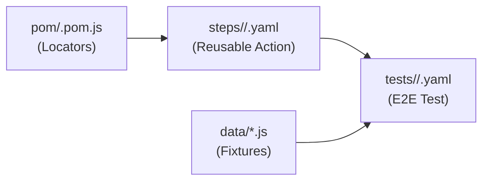

# generate-step: Reusable Action Step Generator

Use this skill when asked to create, refactor, or maintain a reusable action step in `steps/<feature>/<action>.yaml`.

---

## The Role of Tier 2: Step Definitions

Step definitions encapsulate composite user interactions (e.g. logging in, searching for an item, dismissing popups, navigating tabs) so they can be reused across multiple test scenarios.



---

## Strict Rules for Step Files

### 1. Subflow Contract (Zero Flow Headers)
Step files are subflows executed by tests via `runFlow`.
* ⛔ **DO NOT** include `appId: ...`
* ⛔ **DO NOT** include `tags: [...]`
* ⛔ **DO NOT** include `commandTimeout: ...`
* ⛔ **DO NOT** include `launchApp: ...`
* ⛔ **DO NOT** include `---` document separators

### 2. Mandatory POM Imports
Always import the required Page Object Model(s) at the top of the step:
```yaml
- runScript: ../../pom/<screen>.pom.js
```
*(If the step interacts across multiple screens, import each necessary POM file).*

### 3. Zero Hardcoded Selectors
Never write raw element IDs, accessibility labels, or text regexes inside `steps/`.
* ✅ **Correct:** `id: ${output.searchScreen.inputSearchCard}`
* ❌ **Forbidden:** `id: "org.wikipedia.alpha:id/search_card"`

### 4. Zero Hardcoded Test Data (Parameterization)
Steps must be reusable with any test data:
* Accept inputs dynamically via `${<paramName>}` (e.g. `${query}`, `${username}`).
* The calling test passes values via `env:` in `runFlow`.
* ✅ **Correct:** `inputText: ${query}`
* ❌ **Forbidden:** `inputText: "Android"`

### 5. Input Field Hygiene
Whenever typing into an input field, always follow the safe sequence:
```yaml
# 1. Focus the field
- tapOn:
    id: ${output.searchScreen.inputSearchCard}

# 2. Clear any pre-filled or cached text
- eraseText

# 3. Enter parameter value
- inputText: ${query}

# 4. Hide on-screen keyboard
- hideKeyboard
```

### 6. No Arbitrary Sleeps
* Never add `- wait: <ms>`. Maestro commands automatically wait up to their command timeout for elements to appear.

### 7. Clarification Gate (Rule 5)
If you are asked to automate an action whose UI sequence or entry point is unknown:
* **STOP and ask the user for directions** before guessing button taps.

---

## Standard Step Templates

### Pattern A: Navigation Step (`steps/navigation/open-search.yaml`)
```yaml
# Reusable Action Step: Open Search Screen
- runScript: ../../pom/home.pom.js
- runScript: ../../pom/search.pom.js

- tapOn:
    id: ${output.homeScreen.navTabSearch}

# Anchor verification: Confirm arrival on Search screen
- assertVisible:
    id: ${output.searchScreen.inputSearchCard}
```

### Pattern B: Form Input / Search Step (`steps/search/search-article.yaml`)
```yaml
# Reusable Action Step: Search Article
- runScript: ../../pom/search.pom.js

- tapOn:
    id: ${output.searchScreen.inputSearchCard}
- eraseText
- inputText: ${query}
- hideKeyboard

# Wait for search results and tap first item
- tapOn:
    id: ${output.searchScreen.historyList}
```

### Pattern C: Conditional Step (`steps/onboarding/dismiss-onboarding.yaml`)
```yaml
# Reusable Action Step: Dismiss Onboarding
- runScript: ../../pom/onboarding.pom.js
- runScript: ../../pom/home.pom.js

- runFlow:
    when:
      visible: ${output.onboardingScreen.btnForward}
    commands:
      - tapOn: ${output.onboardingScreen.btnForward}
      - tapOn: ${output.onboardingScreen.btnForward}
      - tapOn: ${output.onboardingScreen.btnForward}
      - tapOn: ${output.onboardingScreen.btnSkip}

- assertVisible:
    id: ${output.homeScreen.navTabHome}
```

---

## Pre-flight Lint Verification

After creating or modifying a step, verify syntax across the repository:
```bash
npm run lint
```
