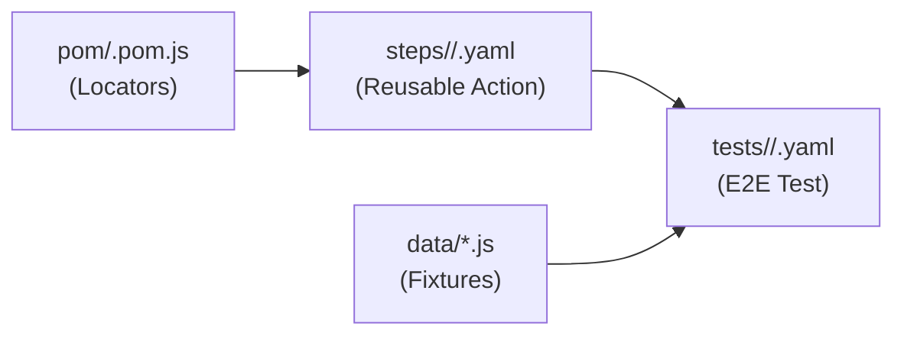

# generate-step: Reusable Action Step Generator

Use this skill when asked to create, refactor, or maintain a reusable action step in `steps/<feature>/<action>.yaml`.

---

## The Role of Tier 2: Step Definitions

Step definitions encapsulate composite user interactions (e.g. logging in, searching for an item, dismissing popups, navigating tabs) so they can be reused across multiple test scenarios.



---

## Strict Rules for Step Files

### 1. Subflow Contract (Minimal Flow Header)
Step files are subflows executed by tests via `runFlow`. Official Maestro CLI requires a `appId: ${APP_ID}` + `---` config section at the top of every YAML file, without scenario-level headers:
* ✅ **Required:** `appId: ${APP_ID}` followed by `---`
* ⛔ **DO NOT** include `tags: [...]`
* ⛔ **DO NOT** include `commandTimeout: ...`
* ⛔ **DO NOT** include `launchApp: ...`

### 2. Mandatory POM Imports
Always import the required Page Object Model(s) at the top of the step:
```yaml
- runScript: ../../pom/<screen>.pom.js
```
*(If the step interacts across multiple screens, import each necessary POM file).*

### 3. Zero Hardcoded Selectors
Never write raw element IDs, accessibility labels, or text regexes inside `steps/`.
* ✅ **Correct:** `id: ${output.loginScreen.inputEmail}`
* ❌ **Forbidden:** `id: "com.example.app:id/input_email"`

### 4. Zero Hardcoded Test Data (Parameterization)
Steps must be reusable with any test data:
* Accept inputs dynamically via `${<paramName>}` (e.g. `${query}`, `${username}`).
* The calling test passes values via `env:` in `runFlow`.
* ✅ **Correct:** `inputText: ${query}`
* ❌ **Forbidden:** `inputText: "Android"`

### 5. Input Field Hygiene
Whenever typing into an input field, always follow the safe sequence:
```yaml
# 1. Focus the field
- tapOn:
    id: ${output.searchScreen.inputSearchCard}

# 2. Clear any pre-filled or cached text
- eraseText

# 3. Enter parameter value
- inputText: ${query}

# 4. Hide on-screen keyboard
- hideKeyboard
```

### 6. No Arbitrary Sleeps
* Never add `- wait: <ms>`. Maestro commands automatically wait up to their command timeout for elements to appear.

### 7. Clarification Gate (Rule 5)
Follow **Rule 5** in `.agents/AGENTS.md`: if the UI sequence or entry point is unknown, check `context/test-flows.md` first, and stop to ask the user before guessing button taps.

---

## Standard Step Templates

### Pattern A: Navigation Step (`steps/navigation/open-settings.yaml`)
```yaml
# Reusable Action Step: Open Settings Screen
- runScript: ../../pom/home.pom.js
- runScript: ../../pom/settings.pom.js

- tapOn:
    id: ${output.homeScreen.navTabSettings}

# Anchor verification: Confirm arrival on Settings screen
- assertVisible:
    id: ${output.settingsScreen.headerTitle}
```

### Pattern B: Form Input Step (`steps/auth/login-user.yaml`)
```yaml
# Reusable Action Step: Login User
- runScript: ../../pom/login.pom.js

- tapOn:
    id: ${output.loginScreen.inputEmail}
- eraseText
- inputText: ${email}
- hideKeyboard

- tapOn:
    id: ${output.loginScreen.btnSubmit}
```

### Pattern C: Conditional Overlay Step (`steps/common/dismiss-promo-banner.yaml`)
```yaml
# Reusable Action Step: Dismiss Optional Promo Banner
- runScript: ../../pom/promo.pom.js

- runFlow:
    when:
      visible: ${output.promoBanner.btnClose}
    commands:
      - tapOn:
          id: ${output.promoBanner.btnClose}
```

---

## Pre-flight Lint Verification

After creating or modifying a step, validate the step file directly (and run `npm run lint` across `steps/` and `tests/`):
```bash
maestro check-syntax steps/<feature>/<action>.yaml
npm run lint
```
