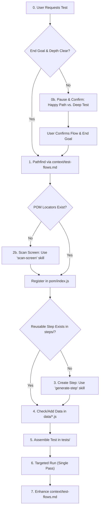

# generate-test: Mobile E2E Test Generator

Use this skill when asked to create a new mobile test scenario, inspect device screens, or author end-to-end test flows.

---

## Core Checklist for Generating New Tests



---

## Step 0: Goal & Depth Confirmation Gate (Clarification Rule)

Before writing any code or step files:
1. **Check if the end goal and test depth are explicitly provided:**
   * If the user gave a specific scenario (e.g., *"Create a test to skip onboarding and verify Home"*), proceed to Step 1.
2. **If the user's request is open-ended or missing the end goal** (e.g. *"Generate test for onboarding"*, *"Test the search feature"*, *"Test saved list"*):
   * **DO NOT GUESS the end goal or test depth.**
   * **PAUSE AND CONFIRM with the user:**
     Ask which test strategy and end condition they want:
     > *"I can generate this test for you. Could you clarify your target flow and expected end goal?*
     > *1. **Happy Path / Specific Flow:** Fast direct flow targeting the primary goal (e.g., bypass onboarding and land on Home).*
     > *2. **Deep Test / Comprehensive Flow:** Thorough verification covering all feature states, slide contents, secondary actions, and edge cases.*
     > *What is the specific end assertion or state you want to verify?"*
3. **Verify Against Guardrails:**
   * Cross-reference `context/app-description.md` to ensure the proposed test does not touch restricted/out-of-scope features (e.g., authentication, restricted tabs).

---

## Step 1: Pathfinding via Navigation Graph (`context/test-flows.md`)

Before authoring steps or guessing navigation:
1. **Consult the Living Navigation Graph:** Read `context/test-flows.md`.
2. **Find the Shortest Verified Route:** Trace the screen transitions from your starting point (e.g., `Cold Start` or `Home`) to your target destination.
3. **Check Section 4 (Learned Nuances & Anti-Patterns):** Review known gotchas for each leg of the journey (e.g., carousel slide counts, modal bottom sheet dismissals, Compose text matching) to avoid repeating past errors.

---

## Step 2: Inspect or Harvest Locators (`pom/`)

1. Check existing POMs in `pom/<screen>.pom.js` (and loaded in `pom/index.js`).
2. If elements or screens are missing:
   * Invoke the **`scan-screen`** skill or run `npm run pom:scan <screen_name>`.
3. Follow **Rule 5 (Clarification Gate)**: If the target screen or navigation path is unknown on the device, stop and ask the user for directions before exploring blindly.
4. Ensure all POM files expose pure locator dictionaries on `output.<screenName>Screen` and are registered in `pom/index.js`.

---

## Step 3: Create Reusable Action Steps (`steps/`)

If the scenario performs a composite user action (e.g. login, dismiss onboarding, search, bookmark):
1. Check if a matching step already exists in `steps/<feature>/<action>.yaml`.
2. If missing, invoke the **`generate-step`** skill to create it:
   * Import POM via `- runScript: ../../pom/<screen>.pom.js`.
   * Reference locators via `${output.<screenName>.<locator>}`.
   * Parameterize dynamic inputs via `${<paramName>}`.
   * Use unambiguous selectors (e.g., exact regex anchors when list items share prefixes) and handle unexpected modals/overlays cleanly based on `context/test-flows.md` or live inspection.
   * Never include `appId`, `tags`, or `launchApp` in a step file.

---

## Step 4: Prepare Test Data (`data/`)

If testing dynamic inputs or unique queries:
* Add static or dynamic fixtures in `data/<feature>-data.js`:
  ```javascript
  output.<feature>Data = {
    validQuery: "Android",
    expectedResult: "Android (operating system)"
  };
  ```

---

## Step 5: Assemble the Test Scenario (`tests/`)

Every test scenario in `tests/` MUST be completely isolated and self-contained:
* **Mandatory `launchApp: clearState: true`:** Every test file must start with `- launchApp: clearState: true`. This guarantees test isolation, prevents state/cache leakage, and ensures any test can be run in any order or in parallel.
* **Declarative Prerequisites:** Never assume leftover state. Any required prerequisite state (e.g., onboarding dismissed, article saved) must be explicitly executed using reusable steps (`steps/`).

Create `tests/<feature>/<scenario-name>.yaml`:
```yaml
appId: ${APP_ID}
tags:
  - smoke
  - <feature>
commandTimeout: 10000
---
# 1. Load Data & POM Locators
- runScript: ../../data/<feature>-data.js
- runScript: ../../pom/index.js

# 2. Mandatory Clean State Launch (Guarantees Test Isolation)
- launchApp:
    clearState: true

# 3. Execution via Reusable Steps (Prerequisites & Feature Actions)
- runFlow: ../../steps/<setup>/<prerequisite>.yaml
- runFlow:
    file: ../../steps/<feature>/<action>.yaml
    env:
      param1: ${output.<feature>Data.validQuery}

# 4. Assertions via POM Locators (Zero Hardcoded IDs)
- assertVisible:
    id: ${output.<screenName>.<anchorLocator>}
```

---

## Step 6: Pre-flight Lint & Targeted Execution (Zero Waste Policy)

1. **Pre-flight Syntax Check:** Validate the target test file and any newly created/modified step files:
   ```bash
   maestro check-syntax tests/<feature>/<scenario-name>.yaml
   ```

2. **Targeted Execution (Single-Run Scope):**
   * Execute **ONLY** the newly created test file:
     ```bash
     ./scripts/run.sh --env staging tests/<feature>/<scenario-name>.yaml
     # Or directly via maestro CLI:
     set -a; source .env; set +a
     MAESTRO_CLI_NO_ANALYTICS=1 maestro test -e APP_ID="$APP_ID" -e APP_ENV="$APP_ENV" tests/<feature>/<scenario-name>.yaml
     ```
   * **Scope Restriction:** NEVER execute `tests/` (the entire suite) or unrelated test files. Only re-run an existing test if a shared step (`steps/`), POM (`pom/`), or fixture (`data/`) that it directly imports was modified.

3. **Single-Pass Completion (No Flakiness Re-runs):**
   * Once the flow achieves a 100% pass (exit code 0, 0 failures), **STOP immediately**.
   * Do not re-run passing tests to "double check" flakiness.

---

## Step 7: Enhance Living Flow Knowledge (`context/test-flows.md`)

After the test passes successfully:
1. Open `context/test-flows.md`.
2. **Update the Mermaid Flowchart:** Add any new screen nodes or transition edges if new screens were mapped.
3. **Update the Routing Table:** Document the new route, reusable step file, required parameters, and anchor verifications.
4. **Log Learned Nuances:** Record any discovered quirks (e.g. modal animations, delayed tooltips, container clickability) under Section 4 so future agents never repeat the same mistake.
