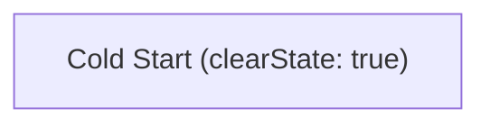

# Application Navigation Graph & Routing Table (`context/test-flows.md`)

This document serves as the living **GPS and Navigation Routing Table** for mobile UI test automation in this repository.
It maps all known application screens (nodes) and the reusable action steps (edges) required to navigate between them.

> **Agent Operating Rule:**
> 1. **Before Authoring a Test:** Always consult this graph to find the shortest verified path from your starting screen to your target screen. Never guess navigation paths or invent transitions if a route is already documented here.
> 2. **After a Test Passes:** The `generate-test` skill must update this file with any new screens, transitions, parameters, or learned gotchas.

---

## 1. Visual Navigation Graph

---

## 2. Screen-by-Screen Routing Table

| Source Screen | Anchor Verification | Target Screen | Reusable Step / Transition | Parameters | Verified Gotchas & Quirks |
| :--- | :--- | :--- | :--- | :--- | :--- |
| *(No routes mapped yet)* | — | — | — | — | — |

---

## 3. Verified End-to-End Scenarios

*(No scenarios verified yet.)*

---

## 4. Learned Nuances & Anti-Patterns (Never Repeat These Mistakes)

*(Document verified UI quirks, animation timing issues, modal dismissal rules, and selector constraints here as flows are built.)*
