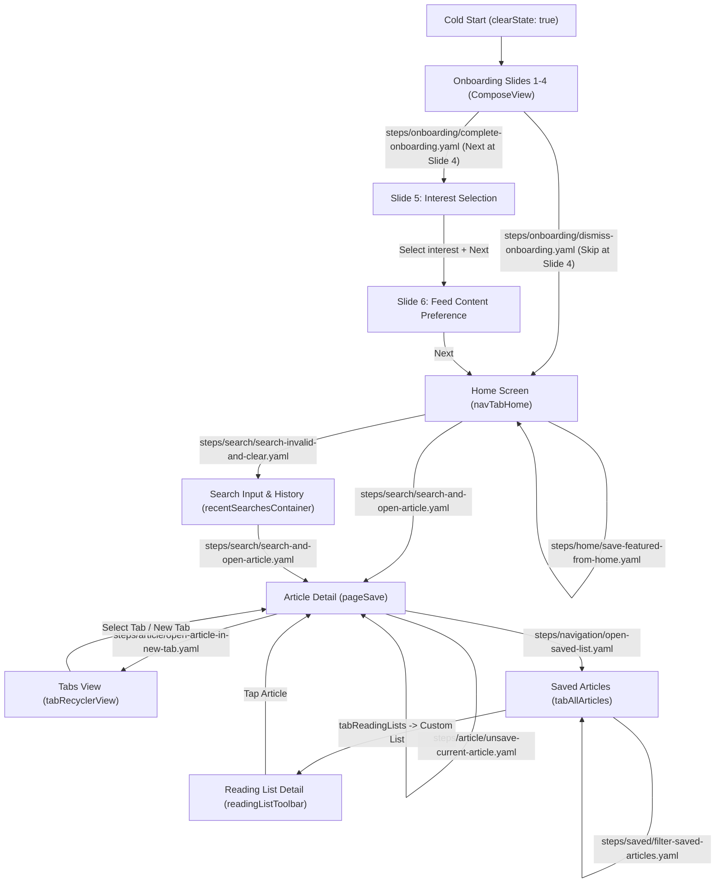

# Application Navigation Graph & Routing Table (`context/test-flows.md`)

This document serves as the living **GPS and Navigation Routing Table** for mobile UI test automation in this repository.
It maps all known application screens (nodes) and the reusable action steps (edges) required to navigate between them.

> **Agent Operating Rule:**
> 1. **Before Authoring a Test:** Always consult this graph to find the shortest verified path from your starting screen to your target screen. Never guess navigation paths or invent transitions if a route is already documented here.
> 2. **After a Test Passes:** The `generate-test` skill must update this file with any new screens, transitions, parameters, or learned gotchas.

---

## 1. Visual Navigation Graph

---

## 2. Screen-by-Screen Routing Table

| Source Screen | Anchor Verification | Target Screen | Reusable Step / Transition | Parameters | Verified Gotchas & Quirks |
| :--- | :--- | :--- | :--- | :--- | :--- |
| `Cold Start` (`onboarding`) | `${output.onboardingScreen.headerSlide1}` | `home` | `steps/onboarding/dismiss-onboarding.yaml` | None | Slides 1–3 advance via `"Forward"`; `"Skip"` only appears starting on Slide 4 (`"Follow your curiosity"`). Home anchored by `id: ${output.homeScreen.navTabHome}`. |
| `Cold Start` (`onboarding`) | `${output.onboardingScreen.headerSlide1}` | `home` | `steps/onboarding/complete-onboarding.yaml` | `interest` (e.g., `"Art"`) | Slides 1–3 advance via `"Forward"`, Slide 4 advances via `"Next"`, Slide 5 requires selecting at least one interest before advancing via `"Next"`, and Slide 6 selects feed preference before `"Next"` lands on Home. |
| `home` | `${output.homeScreen.navTabHome}` | `home` (`Community` / `For you`) | `steps/home/explore-home-tabs.yaml` | None | First tap on `For you` shows `"Swipe to explore"` overlay with `"Got it"` (`btnGotIt`); dismiss conditionally before tapping `Community`. |
| `home` | `${output.homeScreen.headerFeaturedArticle}` | `home` (featured saved) | `steps/home/save-featured-from-home.yaml` | None | Taps `btnSave` scoped `below` `headerFeaturedArticle`, then dismisses optional `designBottomSheet` via `back`. |
| `home` / `search` | `${output.homeScreen.navTabSearch}` | `search` (empty & cleared) | `steps/search/search-invalid-and-clear.yaml` | `invalidQuery` | Searches `invalidQuery`, verifies `txtNoResults` (`"No results"`), and clears via `inputSearchCloseBtn`. |
| `home` / `search` | `${output.homeScreen.navTabSearch}` | `article_detail` | `steps/search/search-and-open-article.yaml` | `query`, `articleTitleRegex` | First visit shows `"A Faster way to Search"` (`btnCloseWidgetPrompt`). Tapping `navTabSearch` while already on Search jumps directly to `inputSearchSrcText` (skipping `inputSearchCard`), so `inputSearchCard` tap is conditional. Scope result tap `below` `inputSearchToolbar`. |
| `article_detail` | `${output.articleDetailScreen.pageSave}` | `article_detail` | `steps/article/inspect-article-tools.yaml` | `findKeyword`, `sectionTitle` | Opens `pageFindInArticle`, verifies `findInPageMatch`, closes `actionModeCloseButton`; opens `pageContents`, asserts `tocList`, jumps to `sectionTitle`. |
| `article_detail` | `${output.articleDetailScreen.pageTheme}` | `article_detail` (themed) | `steps/article/configure-reading-theme.yaml` | `defaultTextSizeLabel` | Increases text size, selects `serif` + `Sepia` theme, waits for `textSizePercent` re-render before `- back` (plus fallback `- back` if sheet remains visible). |
| `article_detail` | `${output.articleDetailScreen.btnPageToolbarButtonTabs}` | `article_detail` (new tab) | `steps/article/open-article-in-new-tab.yaml` | `query`, `articleTitleRegex` | Opens `tabRecyclerView`, taps `btnNewTab`, searches via `btnPageToolbarButtonSearch`, and opens target article in Tab 2. |
| `article_detail` | `${output.articleDetailScreen.pageSave}` | `article_detail` (saved) | `steps/article/save-current-article.yaml` | None | Optional `"Customize your toolbar"` balloon (`btnButtonView`). Tapping `pageSave` opens `designBottomSheet`; dismiss with `- back` (not `touchOutside` center). |
| `article_detail` | `${output.articleDetailScreen.pageSave}` | `article_detail` (custom list) | `steps/article/save-to-new-reading-list.yaml` | `listName`, `listDescription` | Taps `pageSave` -> `btnCreateNewReadingList`, enters `inputReadingListName` & `inputReadingListDescription`, submits `btnDialogOk`. |
| `article_detail` | `${output.articleDetailScreen.pageSave}` | `article_detail` (unsaved) | `steps/article/unsave-current-article.yaml` | None | Taps `pageSave` -> `txtSaved`; if article belongs to a reading list, confirms `"Unsave article?"` via `btnDialogOk`. |
| `article_detail` / `saved_list` / `search` | `${output.savedListScreen.navTabReadingLists}` | `saved_list` | `steps/navigation/open-saved-list.yaml` | None | Uses `- back` from `pageSave` (because `pageToolbar` collapses on scroll), `Navigate up` from `readingListToolbar` and `inputSearchSrcText`, then taps `navTabReadingLists`. |
| `saved_list` | `${output.savedListScreen.tabAllArticles}` | `saved_list` (filtered) | `steps/saved/filter-saved-articles.yaml` | `filterKeyword`, `expectedVisibleRegex`, `expectedHiddenRegex` | Uses `btnMenuSearchLists` (`inputSavedSearch`) to filter by keyword, verifies inclusion/exclusion, closes `actionModeCloseButton`. |

---

## 3. Verified End-to-End Scenarios

| Test File | Tags | Goal & Scope | Verification Result |
| :--- | :--- | :--- | :--- |
| `tests/onboarding/explore-onboarding.yaml` | `regression`, `onboarding` | Walks through all 6 onboarding slides without skipping (verifies slide headers/controls, selects an interest topic on Slide 5, verifies feed preference options on Slide 6), and asserts arrival and feed content on Home (`navTabHome`, `tabCommunity`, `tabForYou`, `headerFeaturedArticle`). | Passed (29/29 steps, 16.7s on `emulator-5554`) |
| `tests/home/save-featured-article.yaml` | `smoke`, `home`, `saved` | Saves the Featured article directly from the Home feed (`Community`), verifies `"Saved"` confirmation, and navigates to `Saved` (`All articles`). | Passed (22/22 steps, 25.2s on `emulator-5554`) |
| `tests/search/search-and-save-article.yaml` | `smoke`, `search`, `saved` | Launches cleanly, dismisses onboarding, searches `"software testing"`, opens the first result (`^Software testing$`), saves the article, navigates to Saved (`All articles`), and verifies the saved article is listed. | Passed (36/36 steps, 39.6s on `emulator-5554`) |
| `tests/search/search-edge-cases-and-history.yaml` | `smoke`, `search` | Verifies `"No results"` empty state for an invalid query, clears via `inputSearchCloseBtn`, searches & opens `"Software testing"`, backs out, and verifies `"Recent searches:"` persistence. | Passed (33/33 steps, 30.2s on `emulator-5554`) |
| `tests/article/theme-and-tabs.yaml` | `regression`, `article` | Opens `"Software testing"`, updates reading text size, serif font, and Sepia theme, opens `"Unit testing"` in a new tab (`tabsCountText: "2"`), verifies both tabs, and switches back to Tab 1. | Passed (53/53 steps, 1m 15s on `emulator-5554`) |
| `tests/saved/reading-list-workflow.yaml` | `regression`, `saved`, `search`, `article` | Full multi-article journey: cold start -> dismiss onboarding -> Home `For you`/`Community` tabs -> search & open `Software testing` -> Find in article + Table of Contents jump -> save to new custom reading list `"QA Research"` -> search & save `Unit testing` -> verify both in Saved -> filter Saved articles -> verify `"QA Research"` list -> open & unsave `Software testing` -> verify removal while `Unit testing` remains. | Passed (110/110 steps, 2m 14s on `emulator-5554`) |

---

## 4. Learned Nuances & Anti-Patterns (Never Repeat These Mistakes)

* **ComposeView Onboarding Without Resource IDs:** The Wikipedia alpha onboarding flow (`org.wikipedia.alpha`) renders in Jetpack Compose without resource IDs. Use text/accessibility labels from `pom/onboarding.pom.js` (`btnForward`, `btnSkip`, `btnNext`, `headerSlide1`–`headerSlide6`).
* **Onboarding Slide 4 Skip vs. Next:** There is no `"Skip"` button on Slides 1–3; you must tap `"Forward"` three times before `"Skip"` and `"Next"` appear on Slide 4 (`"Follow your curiosity"`). Tapping `"Next"` leads to Slide 5 (`"What are you interested in?"`) and Slide 6 (`"What would you like to see first?"`) before reaching Home.
* **Slide 5 Interest Selection Gate:** On Slide 5, `"Select at least one interest"` is shown until an interest chip is tapped, which changes the bar to `"1 selected"` and `"Deselect all"`.
* **Avoid `repeat: while: visible` for Fixed Onboarding Slides:** `repeat: while: visible` waits a full `commandTimeout` (10s) and emits a warning when the condition becomes false. Prefer sequential `runFlow: when: visible:` checks per slide for fast, warning-free, idempotent execution.
* **Home `For you` First-Visit Overlay:** Tapping `For you` for the first time opens `"Swipe to explore"` (`btnGotIt: "Got it"`); dismiss conditionally before tapping `Community`.
* **Search Widget Prompt & Direct Search Shortcut:** On first visit to the Search tab, `"A Faster way to Search"` (`designBottomSheet`) may appear; conditionally tap `"Close"` (`btnCloseWidgetPrompt`). On a second tap of `navTabSearch` while already on the Search tab, Wikipedia jumps straight to `inputSearchSrcText` without showing `inputSearchCard`, so make `inputSearchCard` conditional.
* **Case-Insensitive Text Matching on Search Results:** Maestro's `text:` matching is case-insensitive, so `^Software testing$` can match the `search_src_text` input (`"software testing"`) above the list. Always scope search result taps with `below: id: ${output.searchScreen.inputSearchToolbar}`.
* **Article Detail Collapsible Top Toolbar:** Scrolling down inside an article (e.g. via Table of Contents jump) auto-hides `page_toolbar` (`Navigate up`). Use `- back` when `pageSave` is visible to exit Article Detail reliably.
* **Theme Bottom Sheet Re-render on Theme Change:** Tapping `button_theme_sepia` triggers an async theme re-render; assert `textSizePercent` is visible before sending `- back` (and include a conditional fallback `- back`) so dismissal isn't swallowed during re-render.
* **Dismissing Reading List Bottom Sheet After Save:** Tapping `org.wikipedia.alpha:id/touch_outside` taps the screen center (`y ≈ 1200`), which lands inside `design_bottom_sheet` (`[0,1138][1080,2337]`). Always use `- back` when `designBottomSheet` is visible.
* **Reading List Detail First-Open Tooltip & Unsave Confirmation:** Opening a custom reading list for the first time shows `"Share this reading list with others"` (`buttonView` `"Got it"`). Tapping `"Saved"` on an article belonging to a reading list opens an `"Unsave article?"` confirmation dialog (`android:id/button1`).
