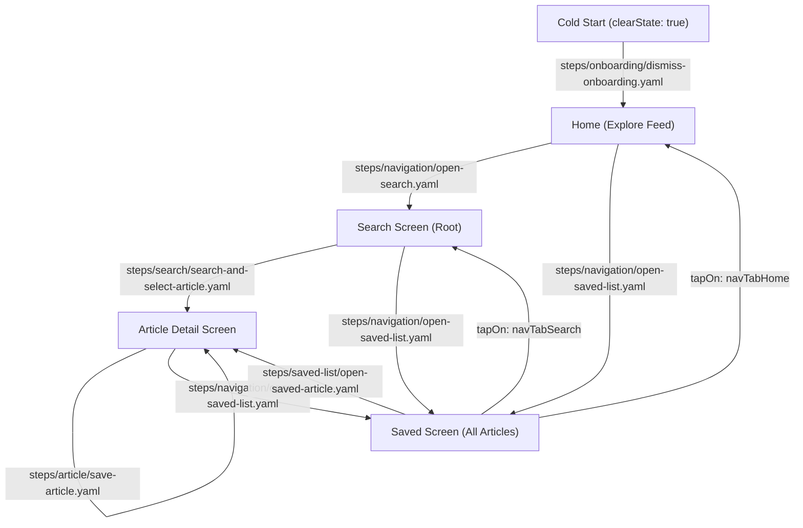

# Application Navigation Graph & Routing Table (`context/test-flows.md`)

This document serves as the living **GPS and Navigation Routing Table** for mobile UI test automation in this repository. 
It maps all known application screens (nodes) and the reusable action steps (edges) required to navigate between them.

> **Agent Operating Rule:**
> 1. **Before Authoring a Test:** Always consult this graph to find the shortest verified path from your starting screen to your target screen. Never guess navigation paths or invent transitions if a route is already documented here.
> 2. **After a Test Passes:** The `generate-test` skill must update this file with any new screens, transitions, parameters, or learned gotchas.

---

## 1. Visual Navigation Graph

---

## 2. Screen-by-Screen Routing Table

| Source Screen | Anchor Verification | Target Screen | Reusable Step / Transition | Parameters | Verified Gotchas & Quirks |
| :--- | :--- | :--- | :--- | :--- | :--- |
| **`Cold Start`** | Onboarding Carousel | **`Home`** | `steps/onboarding/dismiss-onboarding.yaml` | None | "Skip" only exists on Slide 4. Must tap `Forward` x3, then tap `Skip`. |
| **`Home`** | `id: ${output.homeScreen.navTabHome}` | **`Search (Root)`** | `steps/navigation/open-search.yaml` | None | Fresh install triggers *"A Faster way to Search"* promo bottom sheet. Must dismiss via `- back` (tapping "Close" drops during animation). |
| **`Home`** | `id: ${output.homeScreen.navTabHome}` | **`Saved List`** | `steps/navigation/open-saved-list.yaml` | None | Directly taps `navTabReadingLists`. |
| **`Search (Root)`** | `id: ${output.searchScreen.inputSearchCard}` | **`Article Detail`** | `steps/search/search-and-select-article.yaml` | `query`: Search term `expectedTitle`: Article title | Compose result items have `clickable=false`. Must target container using `containsChild: text: ^${expectedTitle}$` with exact regex anchors `^...$` to prevent matching longer titles containing the same substring. |
| **`Search (Root)`** | `id: ${output.searchScreen.inputSearchCard}` | **`Saved List`** | `steps/navigation/open-saved-list.yaml` | None | Exits search mode via `btnNavigateUp` if query active, then taps `navTabReadingLists`. |
| **`Article Detail`** | `id: ${output.articleDetailScreen.pageSave}` | **`Article (Saved)`** | `steps/article/save-article.yaml` | None | Dismisses delayed *"Customize your toolbar"* tooltip if present, taps `pageSave`, and sends `- back` to close the bookmark confirmation bottom sheet. |
| **`Article Detail`** | `id: ${output.articleDetailScreen.pageSave}` | **`Saved List`** | `steps/navigation/open-saved-list.yaml` | None | Article view hides bottom tabs and replaces with article actions. Taps `btnNavigateUp` to exit article, taps `btnNavigateUp` to exit search mode, then taps `navTabReadingLists`. |
| **`Saved List`** | `id: ${output.savedListScreen.mainToolbar}` | **`Article Detail`** | `steps/saved-list/open-saved-article.yaml` | `articleTitle`: Title to open | Dismisses *"Sync reading lists"* card via `btnSyncNotNow` if present, then taps row with `containsChild: text: ^${articleTitle}$`. |
| **`Saved List`** | `id: ${output.savedListScreen.mainToolbar}` | **`Home`** | `tapOn: id: ${output.savedListScreen.navTabHome}` | None | Main bottom nav is directly visible. |
| **`Saved List`** | `id: ${output.savedListScreen.mainToolbar}` | **`Search (Root)`** | `tapOn: id: ${output.savedListScreen.navTabSearch}` | None | Main bottom nav is directly visible. |

---

## 3. Verified End-to-End Scenarios

### `tests/onboarding/dismiss-onboarding-success.yaml`
* **Purpose:** Verify guest user onboarding dismissal and transition to the Home screen.
* **Step Path:** `Cold Start` ➔ `Home`
* **Pipeline:**
  1. `steps/onboarding/dismiss-onboarding.yaml`
  2. Assert `navTabHome` and `navTabSearch` are visible.

### `tests/search/search-and-save-article.yaml`
* **Purpose:** Search for an article, open article details, and save to reading list.
* **Step Path:** `Cold Start` ➔ `Home` ➔ `Search (Root)` ➔ `Article Detail` ➔ `Article (Saved)`
* **Pipeline:**
  1. `steps/onboarding/dismiss-onboarding.yaml`
  2. `steps/navigation/open-search.yaml`
  3. `steps/search/search-and-select-article.yaml` (`query`: "Software Testing", `expectedTitle`: "Software testing")
  4. `steps/article/save-article.yaml`

### `tests/saved-list/open-saved-article-success.yaml`
* **Purpose:** Verify saved list view and open bookmarked article details.
* **Step Path:** `Cold Start` ➔ `Home` ➔ `Search (Root)` ➔ `Article Detail (Save)` ➔ `Saved List` ➔ `Article Detail`
* **Pipeline:**
  1. `steps/onboarding/dismiss-onboarding.yaml`
  2. `steps/navigation/open-search.yaml`
  3. `steps/search/search-and-select-article.yaml`
  4. `steps/article/save-article.yaml`
  5. `steps/navigation/open-saved-list.yaml`
  6. `steps/saved-list/open-saved-article.yaml` (`articleTitle`: "Software testing")
  7. Assert `pageSave` and article title visible.

---

## 4. Learned Nuances & Anti-Patterns (Never Repeat These Mistakes)

1. **Onboarding Carousel Structure:**
   * ❌ *Mistake:* Assuming "Skip" is on Slide 1.
   * ✅ *Rule:* Slide 1 only has `Forward`. Always tap `Forward` x3, then tap `Skip` on Slide 4.

2. **Modal / Bottom Sheet Dismissal:**
   * ❌ *Mistake:* Tapping `Close` on the search promo bottom sheet while it is animating into view (touch event gets dropped).
   * ✅ *Rule:* Use OS key event `- back` to dismiss modals reliably without animation race conditions.

3. **Jetpack Compose Item Taps & Substring Collisions:**
   * ❌ *Mistake:* Using loose substring matching like `tapOn: text: "Software testing"` or `containsChild: text: "Software testing"`. This matches longer titles like `"Software testing controversies"`.
   * ✅ *Rule:* Always wrap text selectors in exact regex boundaries: `^${variable}$`. Target the clickable container with `containsChild: text: ^${variable}$`.

4. **Article Screen Navigation Hierarchy:**
   * ❌ *Mistake:* Trying to tap bottom navigation tabs (`navTabReadingLists`) directly from inside an article.
   * ✅ *Rule:* The article detail screen hides the main bottom navigation and replaces it with article action tabs. You must tap `Navigate up` twice (once to exit article, once to exit search mode) before bottom tabs become accessible.
